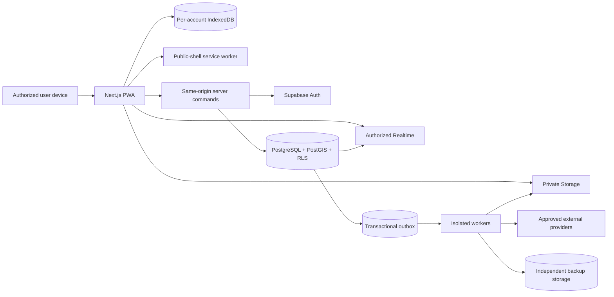

# System Architecture

Status: **ARCHITECTURALLY DEFINED** · Phase 0 review candidate · 2026-11-02

Normative overview: [Phase 0 blueprint](PHASE_0_BLUEPRINT.md). This document is the technical reference; it does not describe deployed infrastructure.

## 1. Architecture decision

Use a modular Next.js App Router application on Vercel with Supabase Auth, PostgreSQL/PostGIS, private Storage and authorized Realtime. Start as one application and one authoritative database, with isolated workers for slow or privileged tasks. Do not introduce microservices, an alternate client-side authority model or a second production results database.

Reasons: shared contracts and transactional invariants; managed authentication/storage; lower operational surface; mobile web delivery without app-store dependence. Tradeoffs: vendor quotas/regions, browser/PWA restrictions, database policy complexity and connection limits. These are release risks to measure, not reasons to bypass RLS.

## 2. Component and trust boundaries

| Component | Responsibility | Trust/control |
|---|---|---|
| Browser UI | Accessible rendering, local validation, draft capture | Untrusted input; no privileged secrets; permissions are UX hints only |
| Service worker | Versioned public shell/static assets, optional sync wake-up | No account HTML/API/evidence caching; no refresh/service credentials |
| IndexedDB | Per-account drafts, reference snapshot, outbox, media and receipts | Origin/device-bound; quota/eviction/shared-device risks explicit |
| Next.js server | Session-aware rendering, same-origin commands, policy-aware orchestration | Validate every request; use user-context DB access by default |
| PostgreSQL | Domain invariants, authorization, transactions, audit/outbox | Authoritative state; RLS and minimal grants |
| Supabase Auth | Identity, recovery, sessions and MFA | Identity provider; application activation/grants remain separate |
| Supabase Storage | Private object bytes and storage policies | Quarantine/original/derivative/export separation |
| Realtime | Invalidations and authorized low-sensitivity event signals | Private topics, membership policies, revocation epoch |
| Workers | Scanning, derivatives, notifications, exports, aggregates, backup replication | Isolated secrets, leased jobs, idempotent effects, least privilege |
| External providers | Email/SMS/push/map/monitoring/backup if approved | Adapter boundary; privacy/cost/failure review; no authority over verification |



## 3. Proposed repository layout after Phase 0 approval

```text
src/app/(public)/                 login, recovery, privacy, terms
src/app/(command)/central/        central modules
src/app/(command)/zone/           district-scoped modules
src/app/(field)/field/            mobile-first agent routes
src/app/(account)/admin/          shared account/security/activity
src/app/api/v1/                   validated same-origin handlers
src/features/<domain>/            schemas, commands, queries, components, tests
src/components/ui/                shadcn-based primitives
src/components/layout/            responsive shells/navigation
src/lib/auth/                     server/browser client boundaries
src/lib/offline/                  IndexedDB, outbox, synchronization
src/lib/observability/            redacted structured logging
supabase/migrations/              reviewed schema/policy migrations
supabase/functions/               isolated workers/adapters where appropriate
tests/                            integration, e2e, accessibility, fixtures
docs/                             controlled engineering documentation
```

This is a proposed layout, not existing application code. Domain modules expose contracts rather than importing one another's private tables/components. Schema types are generated from migrations after Phase 2; Zod command schemas remain explicit and do not blindly accept generated row types.

## 4. Rendering and data access

- Server Components load minimum authorized data; sensitive layouts check session and active authorization server-side.
- Client components handle forms, maps, recording and local synchronization. TanStack Query manages remote interaction state where useful; IndexedDB is the durable draft/outbox authority, not Query's cache.
- React Hook Form + shared Zod schemas give immediate feedback. Database constraints and server commands repeat validation.
- Simple reads may use browser Supabase with RLS. Complex/multi-table writes use route handlers/RPCs. Never trust a client actor, district, role, verification status or receipt time.
- Use user-context credentials for normal operations. Server-only workers use constrained identities; any service-role exception must be documented and tested. No generic privileged proxy.
- Same-origin relative URLs in browser code. No localhost backend URLs in deployed clients. Development/staging/production endpoints come from validated environment configuration.
- Database pooling appropriate for serverless; migration connections separate. Realtime subscriptions are scoped and bounded; reconnect uses cursor/receipt reconciliation.

## 5. Module boundaries and dependencies

Identity → organization/geography → assignments → field submissions → review/incidents/evidence → analytics/GIS/exports. Communications depends on identity, scope and conversation membership. Notifications depend on committed domain events. Offline support is introduced with the first reporting/evidence flows, not retrofitted after all modules.

See [module dependency map](docs/phase-0/MODULE_DEPENDENCY_MAP.md). A module flag can disable an incomplete feature but may never disable authorization, audit or durable receipt for an enabled write.

## 6. Authoritative state and transactions

Submission command transaction:

1. Authenticate and check active account, assignment, permission and applicable MFA.
2. Validate schema, body size, expected version and idempotency fingerprint.
3. Derive scope from approved geography/assignment; lock relevant root/version rows.
4. Insert immutable version and controlled root state; insert review/audit/outbox records as appropriate.
5. Insert idempotency receipt in the same transaction.
6. Commit, then return authoritative receipt. Realtime/provider delivery occurs after commit and may fail independently.

Same key + same fingerprint returns the existing receipt. Same key + different payload is conflict. Distinct agents observing the same PU are not deduplicated against one another. Optimistic version conflicts require a fresh read and explicit correction, not last-write-wins.

Reference numbers are generated server-side from type/election prefix plus a non-sensitive unique sequence/random component; they are not official INEC codes. UUIDs remain the relational identifiers.

## 7. Realtime and notifications

Use private user, district-command, conversation and incident topics. Topic IDs are not permissions. Policies on `realtime.messages` check active membership and operation. Broadcast resource IDs/type/version only; fetch sensitive content through authorized reads. Use RLS-filtered Postgres Changes selectively, not a statewide firehose.

Supabase documents connection-level authorization caching. On suspension, role change or conversation removal, update membership epoch, revoke affected sessions where appropriate and force re-subscription; test actual revocation latency. Do not claim immediate database RLS changes automatically terminate every existing Realtime stream [1](https://supabase.com/docs/guides/realtime/authorization).

Outbox workers use leases, visibility timeouts, bounded retries and dead-letter review. Supabase Queues/PGMQ plus scheduled Edge Function consumers are a candidate implementation, not a deployed choice [1](https://supabase.com/docs/guides/queues/consuming-messages-with-edge-functions). Provider acceptance, device delivery and user read are separate states. Critical priority is internal scheduling, not an OS/network override.

## 8. Design system

### Tokens and visual rules

| Token group | Direction |
|---|---|
| Surface | Navy/charcoal base; white/light gray theme; translucent panels only over controlled backgrounds |
| Action | Restrained teal/blue primary; separate semantic success/warning/danger colors |
| Text | High-contrast primary/secondary; no low-opacity essential instructions |
| Border/elevation | Fine neutral borders, limited shadows; opaque critical surfaces |
| Typography | Approved self-hosted variable font with system fallback; tabular numerals for counts |
| Spacing | 4px base scale; consistent 8/12/16/24/32 rhythm |
| Radius | 8–12px controls; 12–16px panels; no decorative rounding of dense data |
| Focus/motion | Visible focus ring; reduced-motion alternative; no essential animated-only signal |

Initial proposed tokens (contrast verification required in Phase 1):

| Semantic token | Light theme | Dark theme | Use |
|---|---|---|---|
| Canvas | `#F3F6F9` | `#0B1623` | Page background |
| Panel | `#FFFFFF` / controlled translucent white | `#111F30` / controlled translucent navy | Content surfaces; critical forms opaque |
| Primary text | `#172B40` | `#EDF3F8` | Essential content |
| Secondary text | `#526174` | `#B7C5D4` | Metadata; never essential instructions at low opacity |
| Primary action | `#0F766E` with white text | `#5EEAD4` with `#0B1623` text | Main commands; contrast tested per theme |
| Border | `#D7E1E9` | `#2A3D51` | Fine boundaries, not sole focus indicator |
| Success | `#166534` | `#86EFAC` | Text/icon plus label on semantic surface |
| Warning | `#92400E` | `#FCD34D` | Text/icon plus label; not small text on arbitrary glass |
| Danger | `#B42318` | `#FCA5A5` | Emergency/destructive meaning with text/icon |
| Focus | `#2563EB` plus light outer ring | `#93C5FD` plus dark outer ring | Visible keyboard focus; verify against adjacent surface |

Type scale: 12/14/16/20/24/32px; field body minimum 16px to avoid mobile input zoom. Font: approved self-hosted Inter variable or system sans fallback; tabular numerals. Controls minimum 44px, field primary actions 48–56px. Glass blur maximum 12px on decorative panels only; provide solid fallback. Disable blur/transparency for low-power/reduced-transparency settings and critical alerts. Phase 1 implements these tokens in the responsive foundation; see the [design system](docs/phase-1/DESIGN_SYSTEM.md) and [accessibility report](docs/phase-1/ACCESSIBILITY_REPORT.md) for actual scope and limits. Operational forms/data remain planned.

Contrast target: 4.5:1 normal text, 3:1 large text and essential UI boundaries. Do not put small status text over photographs or unpredictable map colors.

### Context-specific layouts

- **Central desktop:** collapsible labeled sidebar; election/time/scope header; global authorized search; main metrics/worklists; persistent critical-alert area; notification drawer. Tables support sorting, pagination and accessible row actions.
- **Zonal tablet:** district badge, larger controls, response queue first, compact coverage comparison, touch-friendly drawers.
- **Field mobile:** assignment and connectivity/sync status; checkin; report/results/incident primary actions; persistent emergency access without covering form controls; bottom navigation with text labels. Secondary media/profile/history actions are progressively disclosed.
- **Shared:** account menu, theme choice, profile/security, notification preferences, session review and accessible sign-out.

All async views implement loading, empty, unauthorized, offline, stale, partial failure and retry states. Confirmation dialogs identify scope and consequences. Destructive actions never silently discard unsent local work. Emergency confirmation is brief and safety-oriented, not a multi-page form.

### Accessibility and localization

WCAG 2.2 AA target; semantic landmarks/headings, keyboard focus order, non-color status labels, screen-reader announcements for sync/alert changes, captions/transcripts where applicable, 44px minimum targets and larger primary field controls. English/Hausa string externalization; translated safety/verification language needs human review. Test at 200% zoom and narrow screens. Map has a list/table equivalent.

## 9. Stack baseline and Phase 1 compatibility gate

Observed npm `latest` on 2026-11-02: Next 16.4.3, React 19.3.1, TypeScript 7.0.2, Tailwind 4.3.3, Supabase JS 2.118.0, Supabase SSR 0.12.7, MapLibre 6.16.0, Zod 4.6.7, TanStack Query 5.105.1, Recharts 3.10.1, Vitest 5.0.5, Playwright 1.64.1. Full observations: [research notes](docs/phase-0/RESEARCH_NOTES.md).

Use the latest stable **compatible** App Router release, pinning exact versions and lockfile after a clean build/test. TypeScript 7/tooling and shadcn/Tailwind compatibility must be proven; if blocked, record a time-bounded exception and approved compatible TypeScript release rather than suppressing errors. Node 22.22.3 is available; align CI/Vercel with an approved supported LTS. No dependency was installed during Phase 0. Phase 1 selected and exercised the compatible set in the [version decision](docs/phase-1/VERSION_DECISION.md), including explicit TypeScript 6.0.3 and ESLint 9.39.5 compatibility exceptions.

## 10. Performance and failure policy

Lazy-load MapLibre, recorder and chart code. Paginate all operational lists. Preaggregate expensive metrics server-side with freshness/scope. Compress derivatives, not original evidence. Use low-resolution capture defaults and text-first submission. Cache reference releases by version. Never cache privileged responses in the public service worker.

Timeouts distinguish connect/read/upload; retry only safe/idempotent operations. Circuit-break optional providers without blocking core intake. Display stale data with timestamp. Acks survive provider failures because they precede outbox delivery. Load, device and recovery tests define actual capacity.

## 11. Architecture decisions still open

Provider regions/budgets, identity contact method, official geography acquisition, scanner, notification vendors, independent backup destination, supported device matrix and legal retention are listed in the [decision register](docs/phase-0/DECISION_REGISTER.md). These are configuration/contract choices, not permission to invent data or weaken boundaries.
