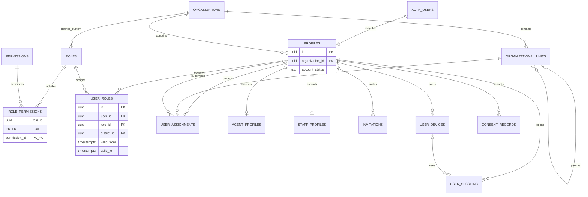
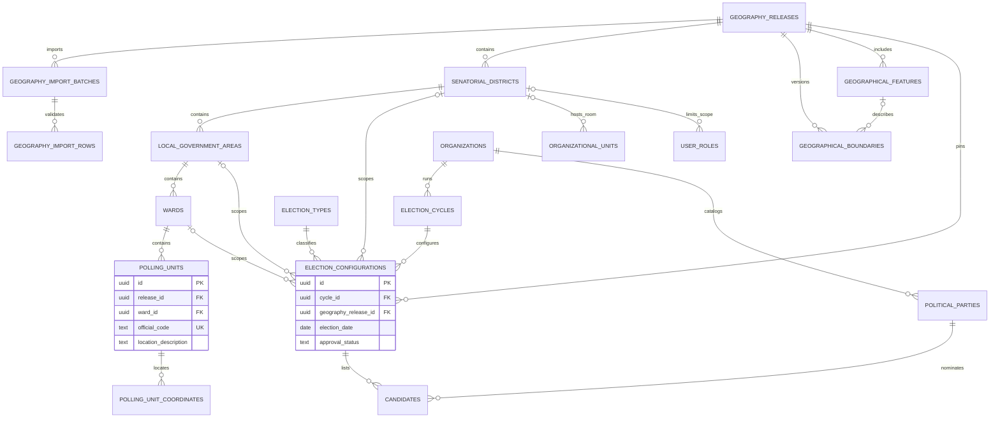
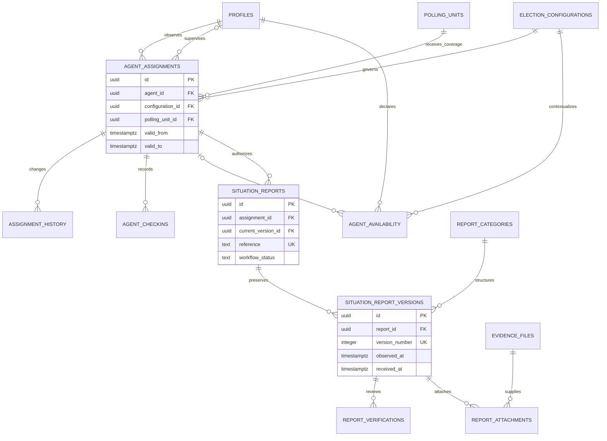
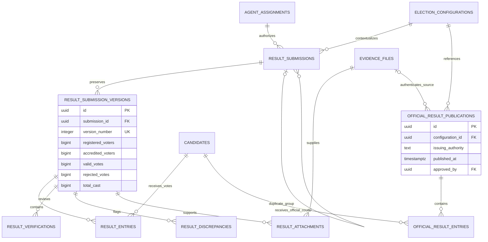
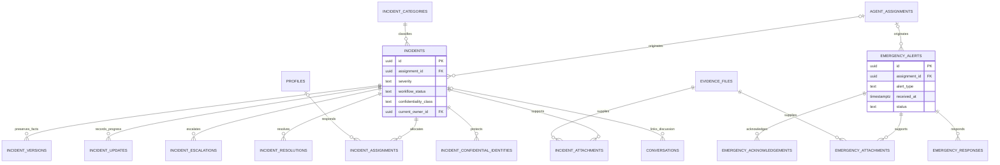
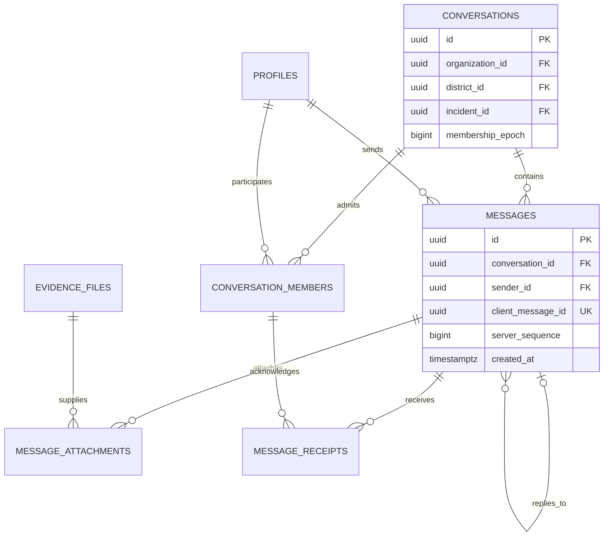
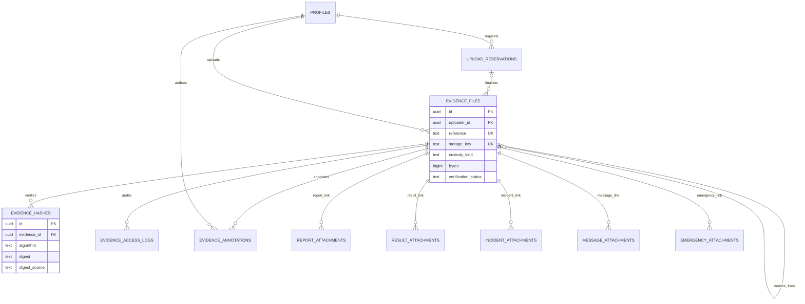
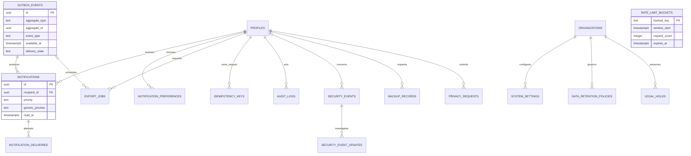
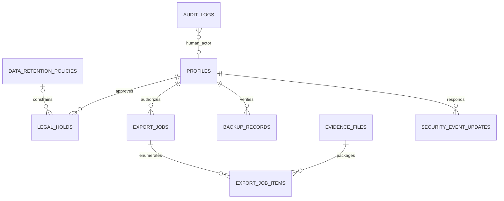

# Complete Conceptual Entity-Relationship Diagram

Status: **ARCHITECTURALLY DEFINED** · 2026-11-02

This is the full conceptual entity inventory, split into readable domain views. Repeated entities connect the views. Every entity has a field/purpose/policy entry in [DATABASE_SCHEMA.md](../../DATABASE_SCHEMA.md). `PK`, `FK` and `UK` identify key concepts, not executable SQL. Additional typed columns and constraints are specified in the dictionary. This is not a migration or a claim that a database exists.

Cardinality: `||--o{` = one parent to zero or more children; `||--||` = required one-to-one; `o|--o{` = optional parent. Join entities resolve many-to-many relationships. Immutable versions/attachments preserve history. Audit/event targets use controlled typed references and do not cascade deletion.

## 1. Organization, identity and access

`AUTH_USERS` is Supabase-owned, not an application-managed password table. Global `PERMISSIONS` is a protected catalog. A custom role belongs to an organization; a system role may have a null organization. `USER_ASSIGNMENTS` is organizational membership, distinct from polling-unit assignments.

## 2. Geography and elections

Same-release composite FKs enforce district→LGA→ward→PU. `GEOGRAPHICAL_BOUNDARIES` has exactly one typed entity target (state feature, district, LGA or ward); those nullable FK columns and check constraint are detailed in the dictionary. PU coordinates are optional and provenance-bearing, never invented.

## 3. Coverage and field reports

The root's current-version FK is deferred within the creation/correction transaction. Versions and reviews are append-only; only controlled root workflow pointers/status change. A local draft/outbox record is not a server report.

## 4. Results and separate official publications

No relationship copies observer figures into official entries. A duplicate-group link preserves independent submissions; exact retry deduplication uses `IDEMPOTENCY_KEYS`. Arithmetic discrepancies are findings, not automatic changes to source figures.

## 5. Incidents and emergency

`INCIDENT_VERSIONS` explicitly preserves initial facts and corrections; `INCIDENT_UPDATES` records response notes/transitions. Confidential source details are not columns freely readable from the incident root. Emergency acknowledgement/response records are append-only.

## 6. Communications

Conversation membership, not district name or knowledge of a UUID, authorizes history. Message receipt identity is the member; sender is derived from the authenticated session. Redaction is an audited restriction with preserved custody, not normal client deletion.

## 7. Evidence custody

Typed attachment tables appear in their owning domain and here to make the cross-domain boundary explicit. Original storage objects have no client update/delete policy. A derivative is never substituted for an original.

## 8. Notifications, reliability and account administration

`RATE_LIMIT_BUCKETS` is an isolated internal utility entity with hashed rate-limit key PK, window/count and expiry; it has no personal-data relationship and no client access. Outbox-to-notification/export is an optional trace link, not a requirement that every event notify a user. Provider attempts are idempotent and distinct from read receipts.

## 9. Governance relationships and deletion boundaries

Governance correlations are append-only event references/manifests, not permission to delete source history when a job expires. Audit targets use validated typed columns or a controlled target registry; the diagram does not invent foreign keys from every domain event into the audit table. Audit rows restrict actor deletion and survive ordinary target retirement under policy. `EXPORT_JOB_ITEMS` is the enforceable manifest join between exports and evidence, with IDs/hashes/bytes captured at generation. Backup verification and security response actions are correlated by request IDs and append-only audit events, not cascading domain relationships.

## 10. Completeness and migration notes

- All minimum entities from the brief are represented. Added entities: geography release/import rows, invitations/consent, immutable result/incident versions, upload reservations, typed attachment tables, official publications, outbox/idempotency, rate limits, privacy/retention/hold and security-event updates.
- `election_types` and `report_categories` are approved reference catalogs, not free-text permissions.
- Composite organization/election/geography constraints are mandatory even where a diagram shows only a simple FK for readability.
- Physical migration order: extensions/schemas/helpers → organization/reference/identity → geography → coverage → reporting/evidence foundations → response/chat/results → governance. Policies/grants/tests accompany each table in the same phase.
- The ERD must be checked against implemented migrations in Phase 2 and updated through change control. This document is not evidence of database verification.
