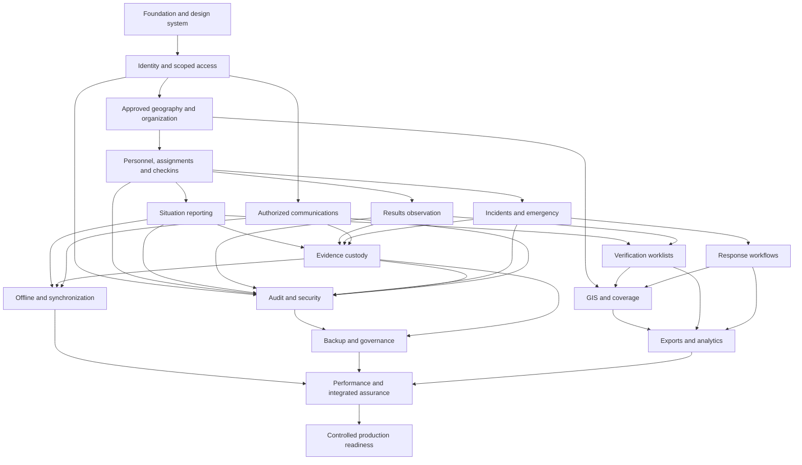

# Module Breakdown and Dependency Map

Status: **ARCHITECTURALLY DEFINED** · 2026-11-02

## 1. Dependency graph

Edges mean dependency on a stable contract, not necessarily completion of every advanced feature. Audit/outbox/idempotency foundations accompany the first sensitive write. Offline field reporting begins in Phase 4; Phase 11 hardens it rather than inventing durability after the fact.

## 2. Module contracts

| Module | Inputs | Durable outputs / owner | Consumers | Phase |
|---|---|---|---|---|
| Foundation | Approved design tokens, environment schema | Layouts, primitives, error/retry patterns | All UI | 1 |
| Identity | Verified auth identity, invitation, delegated grant | Profile, scoped user roles, session/security events | All protected modules | 2 |
| Geography | Approved source files and release manifest | Versioned district→LGA→ward→PU records | Assignments, submissions, GIS | 2–3 |
| Organization | Identity, district and room configuration | Organizational membership/supervision | Personnel, communication, analytics | 3 |
| Coverage | Verified agent, election and PU | Assignments, history, checkins, availability | Field home, reporting, performance | 3 |
| Reporting | Active assignment, category schema | Report root/version, receipt, review events | Command queues, analytics, evidence | 4 |
| Incident | Scoped observation or command entry | Incident, ownership, updates, escalation/resolution | Command response, notifications, GIS | 5 |
| Emergency | Agent/command alert | Alert, acknowledgements, responses | District/central responders | 5 |
| Evidence | Authorized reservation and original bytes | Immutable file/hash/custody/access records | Reports, results, incidents, messages | 6 |
| Communication | Active conversation membership | Messages, attachments, receipts | Authorized participants | 7 |
| Results | Approved election configuration and assignment | Result versions/entries/reviews/discrepancies | Verification queue, approved analytics | 8 |
| Official publication | Authenticated official source and dual approval | Separate publication records/entries | Reference comparison and reports | 8 |
| GIS | Approved geometry + authorized operational records | Scoped map/list responses | Command and field assignment view | 9 |
| Analytics | Committed records and metric definitions | Scoped aggregates with freshness | Dashboards and exports | 9 |
| Notifications | Transactional outbox event | In-app notification and provider attempts | Authorized recipients | 5–10 |
| Audit/security | Sensitive commands and auth/provider events | Append-only audit/security workflow | Governance and auditors | 2 onward |
| Exports | Authorized snapshot/query and purpose | PDF/XLSX/CSV/evidence manifest job | Requester/authorized recipients | 10 |
| Backup/recovery | DB recovery points, object manifests, config | Verified backup/restore records | Recovery operators | 10 |
| Offline | Local draft/media and server receipts | Per-account outbox and reconciliation | Field workflows | 4/6/11 |
| Readiness | Tested modules, people and runbooks | Acceptance evidence and go/no-go decision | Operations | 12–13 |

## 3. Route-to-module inventory

All routes below are planned. Phase 1 may create a labelled layout shell, but a shell is not an implemented module. Exact route protection and API mapping are in [API_DOCUMENTATION.md](../../API_DOCUMENTATION.md).

| Route group | Routes | Backing modules |
|---|---|---|
| Public | `/login`, `/forgot-password`, `/reset-password`, `/privacy`, `/terms` | Auth; approved legal content |
| Central | `/central/dashboard`, `/central/zones`, `/central/agents`, `/central/staff`, `/central/reports`, `/central/results`, `/central/incidents`, `/central/emergency`, `/central/messages`, `/central/gis`, `/central/evidence`, `/central/analytics`, `/central/audit`, `/central/security`, `/central/backups`, `/central/settings` | Statewide scoped modules; each requires its permission |
| District | `/zone/dashboard`, `/zone/agents`, `/zone/assignments`, `/zone/reports`, `/zone/results`, `/zone/incidents`, `/zone/emergency`, `/zone/messages`, `/zone/gis`, `/zone/evidence`, `/zone/analytics`, `/zone/staff` | District-pinned modules; no client-selected unrestricted zone |
| Field | `/field/home`, `/field/assignment`, `/field/checkin`, `/field/report`, `/field/results`, `/field/incident`, `/field/media`, `/field/messages`, `/field/alerts`, `/field/history`, `/field/profile`, `/field/sync` | Own assignment and submissions, local outbox, evidence, communication |
| Shared account | `/admin/profile`, `/admin/notifications`, `/admin/security`, `/admin/activity` | Self profile/preferences/sessions/activity; not a super-admin bypass |

The `/admin/*` prefix is shared account administration only. Central governance lives under permission-protected `/central/*`.

## 4. Cross-cutting rules

- Feature flags control availability, never authorization.
- No module owns a private copy of verification truth. Shared roots/versions and review records are authoritative.
- No circular “notification success required for submission commit” dependency.
- Media attachment may arrive after text receipt; incomplete evidence is explicit.
- Reference releases and election configuration are immutable after approval except documented additive corrections with audit.
- Every module supplies loading/empty/error/offline behavior, authorized test personas, audit events and metric definitions before acceptance.
- Deferred integrations use adapter interfaces and honest disabled states, not fake delivery or map data.
